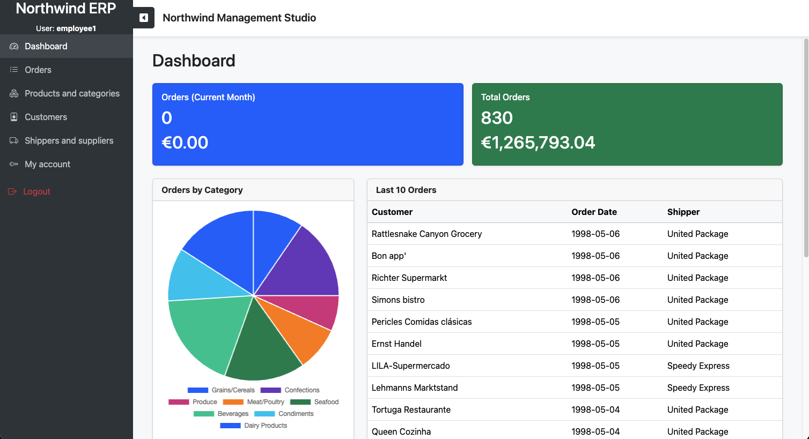
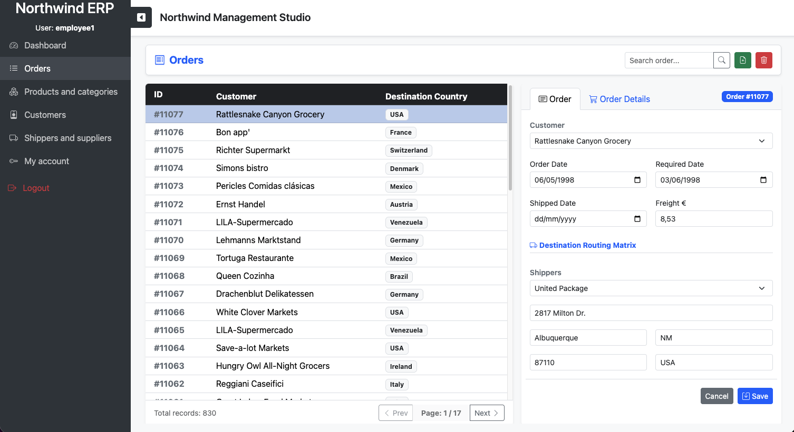
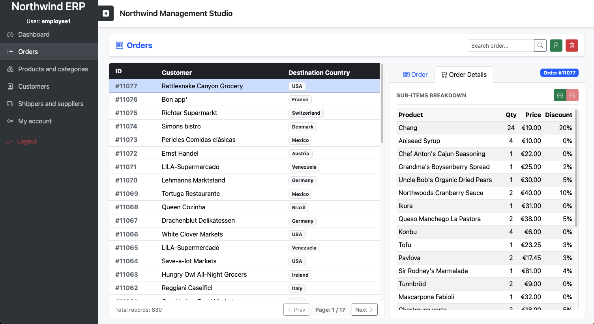
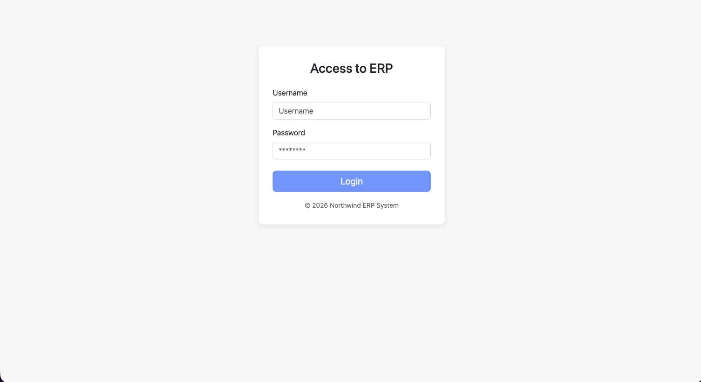

# ERP Replica
This project is a full stack web application that replicates an ERP system: role-based login, orders, the product life cycle and employee management. It's built with Spring Boot and Angular. The database is PostgreSQL, running in Docker, loaded with the Northwind dataset.



# Screenshots

| Orders: edit form | Orders: order lines |
|---|---|
|  |  |



# Tech Stack

| Area | Layer | Technology | Version |
|---|---|---|---|
| Backend | Language | Java | 21 |
| Backend | Framework | Spring Boot | 4.0.5 |
| Backend | Web | Spring Web MVC | 7.0.6 |
| Backend | Persistence | Spring Data JPA + Hibernate ORM | 7.2.7 |
| Backend | Migrations | Flyway | (Boot-managed) |
| Backend | Security | Spring Security | 7.0.4 |
| Backend | API docs | springdoc-openapi (Swagger UI) | 3.0.3 |
| Backend | PDF | OpenPDF | 1.3.30 |
| Backend | Testing | JUnit Jupiter 6 + Mockito 5 + Testcontainers 2 | 6.0.3 / 5.20 / 2.0.4 |
| Frontend | Framework | Angular | 21.2.26 |
| Frontend | Language | TypeScript | 5.9.3 |
| Frontend | UI Framework | Bootstrap | 5.3.9 |
| Frontend | Icons | Bootstrap Icons | 1.13.2 |
| Frontend | Charts | Chart.js | 4.6.1 |
| Frontend | Reactive | RxJS | 7.8.2 |
| Frontend | Testing | Vitest + jsdom | 4.1.12 / 28.1.0 |
| Frontend | Formatter | Prettier | 3.10.1 |
| Frontend | Build | Angular CLI / @angular/build | 21.2.30 |
| Infrastructure | Database | PostgreSQL | 16 |
| Infrastructure | Containerization | Docker + Docker Compose | — |

# Architecture overview

The Angular frontend (`localhost:4200`) talks to the Spring Boot backend (`localhost:8080`) over a JSON REST API: `/api/auth/**` for login/logout and `/api/v1/**` for everything else. The backend reaches PostgreSQL 16 (Docker, `localhost:5432`) through JPA; Flyway creates and migrates the schema on startup.

**Backend** (`spring-erp/`)
- Three layers: `@RestController` (HTTP only) → service interface + `ServiceImpl` (business rules) → Spring Data JPA repository.
- Every request and response body is a DTO (Java records), never a JPA entity; services convert between the two with static converters. Validation (Bean Validation) runs on the request DTOs and returns `400` with the failing fields.
- Services are `@Transactional(readOnly = true)`; methods that write are `@Transactional`, so "check, then write" steps (e.g. "is this customer used by an order?" before a delete) run in one transaction.
- REST conventions: `POST` → `201`, `PUT /{id}` → `200`, `DELETE /{id}` → `204`, missing id → `404`, delete of a referenced row → `409`. Errors share one body: `{ status, message, timestamp }`.
- Lists can be paginated (`?pageNumber=&pageSize=`, page size 1–100). Products, Customers, Suppliers and Employees also accept `&search=`, a case-insensitive search done in the database across all pages.
- Every table has `createdAt` / `updatedAt`, set automatically (Spring Data auditing, read-only in the API).

**Security**
- Session-based authentication (`JSESSIONID` cookie) with Spring Security form login; passwords are stored with BCrypt.
- CSRF protection with a cookie (`XSRF-TOKEN`) that the frontend sends back as the `X-XSRF-TOKEN` header.
- Two roles: every employee is a user; an employee who reports to nobody is a manager. Creating, editing and deleting employees is manager-only (`403` otherwise).
- Passwords: at least 8 characters, at most 72 bytes (BCrypt's limit). Every employee can change their own password (`PUT /api/v1/employees/me/password`, current password required).

**Frontend** (`angular-erp/`)
- Standalone components, template-driven forms, one service per resource.
- Route guards: logged-in users only, and the Employees page for managers only (others get the 404 page).
- One HTTP interceptor shows backend errors in a banner; on a `401` (session expired) it logs out and goes back to the login page with a message. Deletes ask for confirmation in a modal.

# Features

## Dashboard
A recap of the current situation: orders and revenue for the current month and in total, orders by category (pie chart), the last 10 orders, and products with low stock (fewer than 10 units).

## Orders / Products / Customers / Suppliers
Every user can create, edit and delete orders (with their order lines), products and categories, customers, suppliers and shippers. Lists are paginated, and the search box on Products, Customers, Suppliers and Employees searches all pages, not only the one on screen. Deleting something still in use (e.g. a customer with orders) is refused with a message.

Each order also has a PDF report, available through the API (`GET /api/v1/orders/{id}/report`, e.g. from Swagger UI).

## Employees
Only managers see this section. They can create, edit and delete employees; leaving the password empty when editing keeps the current one.

## My account
Every user can change their own password from **My account** in the sidebar.

# Getting Started

## Prerequisites

Make sure you have the following installed before running the project:

- **Java 21** — verify with `java --version`
- **Node.js + npm** — verify with `node -v` and `npm -v`
- **Docker Desktop** — [download here](https://docs.docker.com/desktop/) (for the database and for the backend tests)
- **A SQL editor** (optional) — [DBeaver](https://dbeaver.io/download/)

## Start the database

From the `spring-erp` folder, create your local `.env` from the template and set the DB credentials (it's gitignored, and both Docker Compose and Spring Boot read it):

```bash
cp .env.example .env
```

Then start the PostgreSQL container:

```bash
docker compose up -d
```

To look at the data, connect with DBeaver (or any SQL editor) using these credentials:

| Field | Value |
|---|---|
| Host | localhost |
| Port | 5432 |
| Database | northwind |
| Username | `DB_USERNAME` from `.env` |
| Password | `DB_PASSWORD` from `.env` |

The schema and data are created automatically by Flyway the first time the backend starts (migrations in `spring-erp/src/main/resources/db/migration/`).

## Run the backend

From the `spring-erp` folder (the `.env` file is read from the working directory; in IntelliJ, set the run configuration's working directory to `spring-erp`):

```bash
./mvnw spring-boot:run
```

The backend will start on `http://localhost:8080`.

## Run the frontend

From the `angular-erp` folder:

```bash
npm install
npm start
```

The frontend will be available at `http://localhost:4200`.

## Log in

Open `http://localhost:4200` in your browser and log in with one of the test accounts:

| Username | Password | Role |
|---|---|---|
| manager2 | password123 | Manager |
| employee1 … employee9 (excluding employee2) | password123 | Employee |

# API documentation

With the backend running, Swagger UI is at `http://localhost:8080/swagger-ui.html` (OpenAPI spec at `/v3/api-docs`). To try the protected endpoints, first log in with **Authentication → Log in** (e.g. `manager2` / `password123`), then run any `GET` once so the CSRF cookie is set; after that, `POST` / `PUT` / `DELETE` work too.

Swagger UI and the spec are turned off in the `prod` profile (`SPRING_PROFILES_ACTIVE=prod`), which also stops logging SQL and expects the DB credentials as environment variables.

# Tests

**Backend** — from `spring-erp`:

```bash
./mvnw test
```

Unit tests for every service, MockMvc tests for validation and security, and integration tests that start the whole application against a throwaway PostgreSQL 16 created by Testcontainers (real login, CSRF, Flyway migrations and seed data). **Docker must be running**; the dev database container and `.env` are not needed, and the tests never touch the dev database.

**Frontend** — from `angular-erp`:

```bash
npm test
```

Vitest unit tests for the HTTP services, the two route guards, the error interceptor and the confirm dialog.

# Known limitations

The project is complete for local use. By design, it does not cover:

- configurable CORS: the allowed origin is `http://localhost:4200`;
- a configurable low-stock threshold: it is 10 units;
- a JSON error body on `401` / `403` responses (the frontend shows a generic message for them);
- ending a user's other open sessions when their password changes;
- caching and health/metrics endpoints (Spring Boot Actuator).
